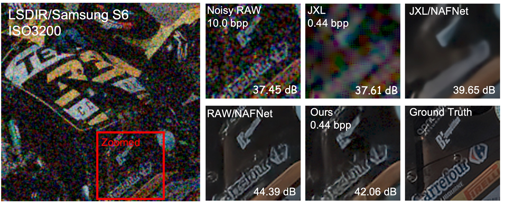

<div align="center">

# Edge-Efficient Joint RAW Compression and Restoration

**Reference implementation for low-bitrate joint RAW compression and
restoration on resource-constrained senders.**

[](requirements.txt)
[](requirements.txt)
[](requirements.txt)
[](requirements.txt)

[Overview](#overview) | [Results](#results) | [Quick Inference](#quick-inference) |
[Training](#training-and-evaluation) | [Data](#data-preparation)

</div>

## Overview

Full-size RAW restoration models are expensive to run on a wearable sender.
Compressing noisy RAW with a conventional codec before restoration also spends
bits on sensor noise. Our asymmetric model instead runs a lightweight analysis
transform and hyperprior on the sender. The backend jointly decompresses and
restores the clean linear-RGB image.

<p align="center">
  
</p>

This release focuses on the paper method:

- **Ours-M:** the primary medium-size sender;
- **Ours-S:** a narrower sender distilled from a rate-matched Ours-M teacher;
- **whole-image coding:** real factorized-hyperprior and main-latent rANS
  streams in a self-describing `.craw` container;
- **paper training path:** SIDD and synthetic-LSDIR preparation, training, and
  fixed-set evaluation for Ours-M/S.

Ours-M and Ours-S use independent checkpoints and decoder weights. Exploratory
models, historical experiments, and baseline implementation code are excluded
from this inference-oriented release.

## Results

### Visual comparison

<p align="center">
  
</p>

### Rate-restoration performance

PSNR and MS-SSIM are measured in camera-linear RGB. LPIPS is measured after the
fixed camera-to-sRGB rendering path. Every plotted point uses a complete fixed
1024-image validation set.

<p align="center">
  
</p>

| Dataset | bpp | PSNR (dB) | MS-SSIM | LPIPS |
|:---|---:|---:|---:|---:|
| SIDD | 0.2509 | 52.90 | 0.99529 | 0.13392 |
| LSDIR | 0.9841 | 45.82 | 0.99508 | 0.10936 |

## Installation

The reference environment uses Python 3.11, PyTorch 2.11.0, CUDA 12.8, and
CompressAI 1.2.8. All Python dependencies are listed in one file:

```bash
python -m venv .venv
source .venv/bin/activate
python -m pip install --upgrade pip
python -m pip install -r requirements.txt
```

## Quick Inference

Quick inference runs one complete 5328x3000 Bayer frame. It does not crop,
tile, stitch, or extrapolate patch bitrate. Ours-S is the default model and
checkpoint for this example. Download it first:

```bash
bash scripts/download_ours_s_checkpoint.sh
```

The included input is a headerless, unpacked, little-endian `uint16` RAW file.
Its JSON sidecar records the dimensions, native CFA, 10-bit black/white levels
(32/1023), ISO, exposure, AWB, and camera-to-sRGB matrix.

### Stage 1: RAW encoding

The sender reads `.raw`, performs the Ours-S analysis and hyper-analysis
transforms, quantizes both latents, and entropy-codes them into `.craw`:

```bash
python quick_inference.py encode \
  --input assets/sidd_s6_iso3200/sidd_0104_s6_iso3200_noisy.raw \
  --metadata assets/sidd_s6_iso3200/sidd_0104_s6_iso3200_noisy.json \
  --decoder-id ours_s \
  --checkpoint checkpoints/ours_s_lambda6e4_176k/inference_fp16.pth \
  --output outputs/sidd_0104_ours_s.craw \
  --device cuda
```

The example output is 640,077 bytes. Relative to the original 5328x3000 Bayer
frame, the complete file is **0.320359 bpp**. This value includes the 2,225-byte
container header; the rANS payload alone is 0.319245 bpp.

### Stage 2: CRAW decoding and rendering

The receiver reads only `.craw` plus the matching decoder checkpoint. It
entropy-decodes the latents, reconstructs linear RGB, and applies the AWB, CCM,
and gamma metadata embedded in `.craw` to save a display PNG:

```bash
python quick_inference.py decode \
  --input outputs/sidd_0104_ours_s.craw \
  --checkpoint checkpoints/ours_s_lambda6e4_176k/inference_fp16.pth \
  --reconstruction outputs/sidd_0104_ours_s.png \
  --device cuda
```

Inspect the bitstream without decoding it:

```bash
python quick_inference.py inspect --input outputs/sidd_0104_ours_s.craw
```

An optional higher-rate Ours-M checkpoint is also released. Download it with:

```bash
bash scripts/download_ours_m_checkpoint.sh
```

To use Ours-M, pass `--decoder-id ours_m` and
`--checkpoint checkpoints/ours_m_lambda0300_100k/inference_fp16.pth` during
encoding, then use the same checkpoint during decoding. The decoder ID stored
in `.craw` prevents accidentally decoding an Ours-M stream with Ours-S weights.
The command defaults remain Ours-S.

<p align="center">
  
</p>

### CRAW contract

A `.craw` file contains the `ERICCRW1` magic, a compact JSON header, one
factorized hyper-latent rANS stream, and one Gaussian main-latent rANS stream.
The header stores image geometry, CFA, color metadata, stream checksums, and
`decoder_id` (`ours_m` or `ours_s`). It does not embed model weights. A decoder
must therefore use the matching checkpoint. The precomputed example at
`assets/sidd_s6_iso3200/sidd_0104_ours_s.craw` can be decoded directly.

## Data Preparation

Set a portable data root and download the official datasets after accepting
their terms:

```bash
export DATA_ROOT=/path/to/data
bash tools/data/download_sidd_medium_raw.sh "$DATA_ROOT/SIDD"
bash tools/data/download_lsdir.sh "$DATA_ROOT/LSDIR"
bash tools/data/extract_lsdir_hr.sh "$DATA_ROOT/LSDIR"
```

Prepare and verify the canonical SIDD split:

```bash
python tools/data/prepare_sidd_lmdb.py \
  --source-root "$DATA_ROOT/SIDD/medium_raw/SIDD_Medium_Raw/Data" \
  --output-root "$DATA_ROOT/SIDD/nafnet_raw_to_linear_spatial_rggb"

python tools/data/verify_dataset.py --data-root "$DATA_ROOT"
```

Training spatially canonicalizes native CFA patterns to RGGB. SIDD is stored as
a normalized black-level-subtracted signal and mapped to the paper convention
with normalized black level `512/16383`. Synthetic LSDIR follows inverse
rendering, the calibrated S6 noise model, and the same target convention. The
quick-inference sample uses BL/WL `32/1023`; its normalized black level differs
by less than 0.003% from the paper convention.

## Training and Evaluation

The shortest paper reproduction path trains the Ours-M base and its
`lambda=6e-4` operating point:

```bash
export DATA_ROOT=/path/to/data
bash scripts/reproduce_ours_m_lambda6e4.sh
```

Train Ours-S with the released configuration:

```bash
bash scripts/train_ours_s_lambda6e4.sh
```

Evaluate a checkpoint on the fixed validation sets:

```bash
python evaluate.py \
  --config configs/experiments/ours_s_lambda6e4_joint180k.yaml \
  --checkpoint checkpoints/ours_s_lambda6e4_176k/inference_fp16.pth \
  --dataset sidd_real --dataset lsdir_high_texture
```

The frozen protocol uses total coded bits divided by target pixels. PSNR and
MS-SSIM use normalized camera-linear RGB; LPIPS uses the fixed rendered sRGB
domain. Only complete fixed-set evaluations are paper points.

## Repository Structure

```text
assets/                 paper figures and whole-image RAW/CRAW example
checkpoints/            released-checkpoint download contract
configs/                Ours-M/S data, degradation, model, and training configs
raw_codec/              model, entropy coding, RAW I/O, data, losses, and metrics
scripts/                checkpoint download and Ours-M/S reproduction commands
tools/data/             official data download, conversion, and verification
tests/                  RAW, CFA, color, CRAW, config, and model contract tests
quick_inference.py      whole-image .raw -> .craw -> .png entry point
train.py                Ours-M/S trainer
evaluate.py             fixed-set evaluator
requirements.txt        complete Python environment
```

The tests are intentionally retained for secondary development. They are small
and guard the public bitstream format, black-level mapping, CFA geometry, color
rendering, and Ours-M/S tensor contracts:

```bash
pytest
```

## Released Checkpoints

Both released files are inference-only FP16 checkpoints. Training state,
optimizer state, and baseline weights are excluded. Ours-S remains the default
for `quick_inference.py`.

| Model | Operating point | Path | Size | SHA-256 |
|:---|:---|:---|---:|:---|
| Ours-S | `lambda=6e-4`, step 176k | `checkpoints/ours_s_lambda6e4_176k/inference_fp16.pth` | 44,983,782 bytes | `31d5966026cedf7773bafe62e67d47cdcd00968b805e1840a2040e00c8acb55c` |
| Ours-M | `lambda=3e-4`, step 100k | `checkpoints/ours_m_lambda0300_100k/inference_fp16.pth` | 62,754,620 bytes | `4d7c03371dbe19a9cdb74b832373d8f9eabd18c1d98329c788549ad550613a6a` |

See [`checkpoints/README.md`](checkpoints/README.md) for download links and
verification commands.

## Citation

The paper citation will be added after the authors approve the final public
metadata.

## License and Third-Party Software

This staging repository does not yet assign a project license or author list.
Upstream model components and datasets retain their respective terms.
See [`THIRD_PARTY_NOTICES.md`](THIRD_PARTY_NOTICES.md) for details.
