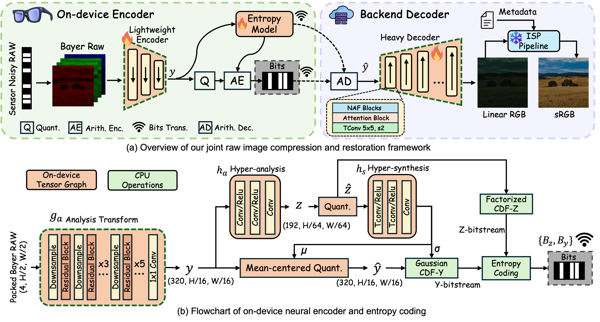
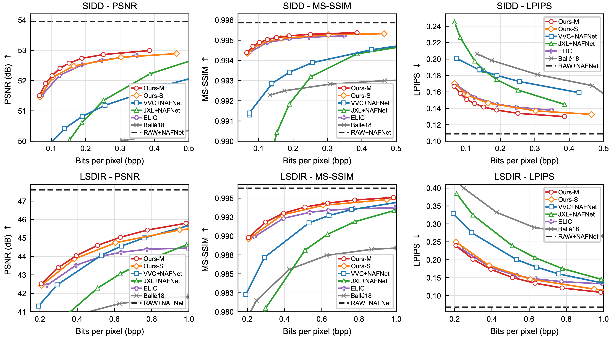
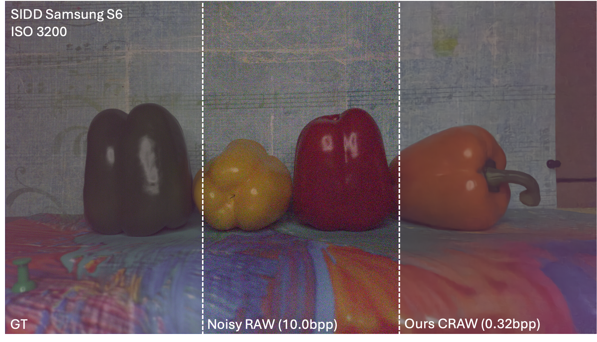

# CRAW

**Implementation for "Edge-Efficient Joint RAW Image Compression and Restoration for Smart Wearable Devices"**

[Preprint](https://arxiv.org/abs/2611.24805) | [Project Page]()｜[Code](#)

[](https://arxiv.org/abs/2611.24805)
[](requirements.txt)
[](requirements.txt)
[](requirements.txt)
[](requirements.txt)

## Overview

CRAW uses a lightweight encoder on wearable devices and jointly decompresses
and restores clean linear-RGB images on the backend.

<p align="center">
  
</p>

This repository includes:

- **Ours-M:** the primary medium-size sender;
- **Ours-S:** a narrower sender distilled from a rate-matched Ours-M teacher;
- **whole-image coding:** rANS streams in a self-describing `.craw` container;
- **training and evaluation:** data preparation and fixed-set evaluation on
  SIDD and synthetic LSDIR.

Ours-M and Ours-S use separate checkpoints and decoder weights.

## Results

### Visual comparison

<p align="center">
  
</p>

### Rate-restoration performance

PSNR and MS-SSIM use camera-linear RGB; LPIPS uses rendered sRGB. Each point is
evaluated on the fixed 1024-image validation set.

<p align="center">
  
</p>

## Installation

Reference environment: Python 3.11, PyTorch 2.11.0, CUDA 12.8, and CompressAI
1.2.8.

```bash
python -m venv .venv
source .venv/bin/activate
python -m pip install --upgrade pip
python -m pip install -r requirements.txt
```

## Quick Inference

The example processes a complete 5328x3000 Bayer frame with Ours-S. Download
the checkpoint first:

```bash
bash scripts/download_ours_s_checkpoint.sh
```

The input is a headerless little-endian `uint16` RAW file. Its JSON sidecar
contains image and camera metadata.

### Stage 1: RAW encoding

Encode RAW to `.craw`:

```bash
python quick_inference.py encode \
  --input assets/sidd_s6_iso3200/sidd_0104_s6_iso3200_noisy.raw \
  --metadata assets/sidd_s6_iso3200/sidd_0104_s6_iso3200_noisy.json \
  --decoder-id ours_s \
  --checkpoint checkpoints/ours_s_lambda6e4_176k/inference_fp16.pth \
  --output outputs/sidd_0104_ours_s.craw \
  --device cuda
```

### Stage 2: CRAW decoding and rendering

Decode `.craw` and render a PNG:

```bash
python quick_inference.py decode \
  --input outputs/sidd_0104_ours_s.craw \
  --checkpoint checkpoints/ours_s_lambda6e4_176k/inference_fp16.pth \
  --reconstruction outputs/sidd_0104_ours_s.png \
  --device cuda
```

Inspect the bitstream without decoding it:

```bash
python quick_inference.py inspect --input outputs/sidd_0104_ours_s.craw
```

For the optional higher-rate Ours-M model:

```bash
bash scripts/download_ours_m_checkpoint.sh
```

Pass `--decoder-id ours_m` and its checkpoint during encoding, then use the
same checkpoint for decoding. Ours-S remains the default.

<p align="center">
  
</p>

### CRAW contract

A `.craw` file contains the `ERICCRW1` magic, a JSON header, and two rANS
streams. The header stores image/color metadata, checksums, and `decoder_id`.
Model weights are not embedded, so decoding requires the matching checkpoint.
A precomputed example is included in `assets/sidd_s6_iso3200/`.

## Data Preparation

After accepting the dataset terms, download the data:

```bash
export DATA_ROOT=/path/to/data
bash tools/data/download_sidd_medium_raw.sh "$DATA_ROOT/SIDD"
bash tools/data/download_lsdir.sh "$DATA_ROOT/LSDIR"
bash tools/data/extract_lsdir_hr.sh "$DATA_ROOT/LSDIR"
```

Prepare and verify the canonical SIDD split:

```bash
python tools/data/prepare_sidd_lmdb.py \
  --source-root "$DATA_ROOT/SIDD/medium_raw/SIDD_Medium_Raw/Data" \
  --output-root "$DATA_ROOT/SIDD/nafnet_raw_to_linear_spatial_rggb"

python tools/data/verify_dataset.py --data-root "$DATA_ROOT"
```

Training canonicalizes CFA patterns to RGGB. See the data tools and configs for
normalization and synthetic-noise settings.

## Training and Evaluation

Reproduce the Ours-M `lambda=6e-4` operating point:

```bash
export DATA_ROOT=/path/to/data
bash scripts/reproduce_ours_m_lambda6e4.sh
```

Train Ours-S:

```bash
bash scripts/train_ours_s_lambda6e4.sh
```

Evaluate a checkpoint on the fixed validation sets:

```bash
python evaluate.py \
  --config configs/experiments/ours_s_lambda6e4_joint180k.yaml \
  --checkpoint checkpoints/ours_s_lambda6e4_176k/inference_fp16.pth \
  --dataset sidd_real --dataset lsdir_high_texture
```

Paper results use complete fixed-set evaluations and total coded bits per target
pixel.

## Repository Structure

```text
assets/                 paper figures and whole-image RAW/CRAW example
checkpoints/            released-checkpoint download contract
configs/                Ours-M/S data, degradation, model, and training configs
raw_codec/              model, entropy coding, RAW I/O, data, losses, and metrics
scripts/                checkpoint download and Ours-M/S reproduction commands
tools/data/             official data download, conversion, and verification
tests/                  RAW, CFA, color, CRAW, config, and model contract tests
quick_inference.py      whole-image .raw -> .craw -> .png entry point
train.py                Ours-M/S trainer
evaluate.py             fixed-set evaluator
requirements.txt        complete Python environment
```

Run the tests with:

```bash
pytest
```

## Released Checkpoints

Released checkpoints are inference-only FP16 weights. Ours-S is the default for
`quick_inference.py`.

| Model | Operating point | Path | Size | SHA-256 |
|:---|:---|:---|---:|:---|
| Ours-S | `lambda=6e-4`, step 176k | `checkpoints/ours_s_lambda6e4_176k/inference_fp16.pth` | 44,983,782 bytes | `31d5966026cedf7773bafe62e67d47cdcd00968b805e1840a2040e00c8acb55c` |
| Ours-M | `lambda=3e-4`, step 100k | `checkpoints/ours_m_lambda0300_100k/inference_fp16.pth` | 62,754,620 bytes | `4d7c03371dbe19a9cdb74b832373d8f9eabd18c1d98329c788549ad550613a6a` |

See [`checkpoints/README.md`](checkpoints/README.md) for download links and
verification commands.

## Citation

Citation metadata will be added after approval.

## License and Third-Party Software

Project license and author information are pending. See
[`THIRD_PARTY_NOTICES.md`](THIRD_PARTY_NOTICES.md) for third-party terms.
